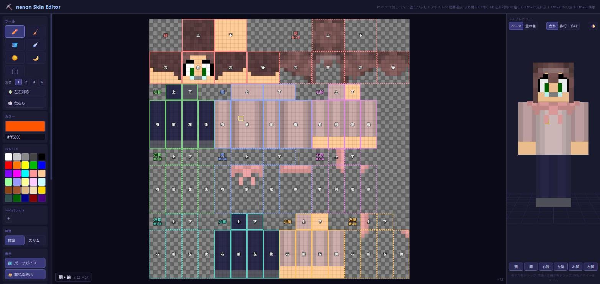

# nenon Skin Editor

Minecraft（Java版）のスキンを、3Dで確認しながら描けるエディタです。
展開図と3Dモデルのどちらにも直接描けて、いま描いている場所が体のどこなのかが常に分かります。



> これは個人が作った非公式ツールです。Mojang および Microsoft とは関係がなく、承認や支援を受けたものでもありません。
> Minecraft は Mojang Synergies AB の商標です。

## Web版

インストールせずに、ブラウザでそのまま使えます。

**<https://ankakepizza551.github.io/nenon-skin-editor/>**

Web版では、保存は PNG のダウンロードになります（同じファイルへの上書き保存はできません）。それ以外の機能はデスクトップ版と同じです。

## ダウンロード

[Releases](../../releases) から Windows 用の exe をダウンロードできます。

- `nenon.Skin.Editor.Setup.x.x.x.exe`：インストーラー版
- `nenon.Skin.Editor.x.x.x.exe`：インストール不要のポータブル版

コード署名をしていないため、初回起動時に Windows の SmartScreen 警告が出ます。「詳細情報」→「実行」で起動できます。

## 主な機能

### 描く

- ペン / 消しゴム / 塗りつぶし / スポイト / 明るく・暗くするブラシ
- ブラシの太さ 1〜4 ピクセル。太いブラシも塗りつぶしも、いま描いている面の外にははみ出しません
- 左右対称描画：頭と胴は同じパーツ内で折り返し、腕と脚は反対側の手足に写ります
- 色むら：色を1ピクセルごとに少しだけ明るく／暗くばらつかせて、べた塗りに質感を付けます
- 範囲選択：選んだ部分をドラッグや矢印キーで動かす、複製する、消す
- 反転コピー：右半身を左半身へ（またはその逆へ）鏡写しでコピー

### 3Dで確認する

- 3Dモデルに直接描けます。描く先（ベース／重ね着）は切り替えられます
- 展開図でカーソルを置いた場所が3Dモデル上で光り、3Dモデルに置くと展開図側が光ります
- パーツガイド：展開図に、パーツ名と面（前・後・右・左・上・下）を枠で表示します
- ポーズ切り替え（立ち／歩行／広げ）、パーツごとの表示切り替え、背景色の切り替え
- 標準（クラシック / Steve、腕4px）とスリム（Alex、腕3px）の両方に対応

### ファイル

- 64×64 の PNG を読み込み・保存（ドラッグ＆ドロップでも読み込めます）
- 旧形式の 64×32 スキンは 64×64 に変換して読み込みます
- 読み込んだファイルを覚えていて、Ctrl+S で上書き保存します
- 自動保存：保存せずに終了しても、次回起動時に復元できます
- 元に戻す / やり直す（100手まで）

### その他

- 参考画像：見本の画像をエディタの上に重ねて表示し、クリックで色を取得できます
- マイパレット：よく使う色を登録しておけます

## 知っておくとよいこと

- 「右」「左」はキャラクター自身から見た向きです。正面から見ると、右腕は画面の左側に来ます。
- ベース層の透明な部分は、実際のゲームと同じく3Dプレビューでは黒く表示されます。
- 重ね着の枠は点線で表示されます。

## 操作

| 操作 | キー |
| --- | --- |
| ペン / 消しゴム / 塗りつぶし / スポイト | P / E / F / I |
| 明るく / 暗く | L / D |
| 範囲選択 | S |
| ブラシを細く / 太く | [ / ] |
| 左右対称の切り替え | M |
| 色むらの切り替え | N |
| 元に戻す / やり直す | Ctrl+Z / Ctrl+Y |
| 保存 / 名前を付けて保存 | Ctrl+S / Ctrl+Shift+S |
| 展開図の移動 | Alt+ドラッグ、または中ボタンドラッグ |
| 展開図のズーム | ホイール |
| 3Dの回転 | モデルのない所をドラッグ、または右ドラッグ |

範囲選択中は、矢印キーで移動（Shift で4ピクセルずつ）、Ctrl+ドラッグで複製、Delete で消去、Esc で解除です。

## 開発

React + TypeScript + Vite + Three.js 製で、Electron でデスクトップアプリにしています。ブラウザでもそのまま動きます。

```sh
npm install
npm run dev                  # ブラウザで開発（http://localhost:5173）
npm run electron:dev         # Electron で開発
npm run lint
npm run electron:build:win   # release/ に exe を出力
```

## ライセンス

[MIT License](LICENSE)
